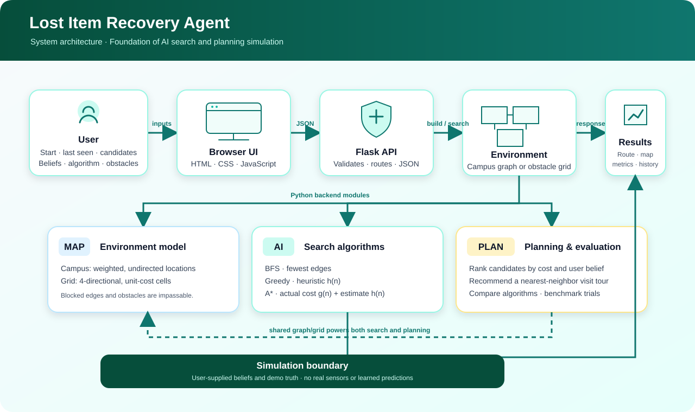

# Lost Item Recovery Agent

A Foundation of AI project that models finding a misplaced item as a search-and-planning problem. It offers a browser interface backed by a local Flask API, with Python implementations of BFS, Greedy Best-First Search, and A*.

> **Scope:** This is an educational simulation. It does not detect real objects, use live campus data, or learn probabilities from past searches. Candidate beliefs and the simulated actual item location are supplied by the user.

## Project architecture

The browser collects the search inputs, the Flask API validates and forwards them to the Python environment/search/planning modules, and the result is returned to the browser for visualization.



The SVG diagram is an original project asset and can be reused in presentations and reports. The web interface also produces benchmark charts; see [Benchmarks](#benchmarks).

## Features

- **Campus search planning:** Models the default campus as a weighted, undirected graph with 20 locations and 26 corridors. Users can select an item category, current location, last-seen location, candidate rooms, previously visited rooms, subjective likelihood beliefs, and blocked corridors.
- **Candidate ranking:** Runs the selected route-finding algorithm from the start to each candidate and scores reachable candidates using travel cost, room inspection effort, and user belief.
- **Recovery mission simulation:** Visits candidates in the recommended order, replans from each reached location, and reports recovery when it reaches the user-selected simulated actual location.
- **Interactive grid practice:** Generates a seeded obstacle grid, lets users select start and goal cells, and visualizes the explored cells and route.
- **Algorithm comparison:** Runs BFS, Greedy, and A* on the same campus start/goal pair and compares route and search metrics.
- **Campus configurator:** Adds rooms and weighted corridors, supports blocked corridors in searches, restores the default map, and tests the campus Euclidean heuristic for admissibility and consistency.
- **Recovery history:** Displays recent searches, allows loading a previous search's basic locations, exporting history as JSON, or clearing it.
- **Benchmarks:** Runs quick, standard, or custom experiments; reports summary metrics and provides raw and summary CSV data. Benchmark runs also save charts and CSV evidence under `output/`.
- **Coursework guide:** Includes an in-app PEAS specification, search formulation, heuristic discussion, and limitations.
- **Local-only operation:** The app binds to `127.0.0.1`; no external service or database is required.

## User workflow

1. Start the app and open `http://127.0.0.1:5000`.
2. In **Find Lost Item**, choose the item category, current location, last-seen location, and candidate rooms. Optionally add visited rooms, adjust beliefs, and mark blocked corridors.
3. Choose BFS, Greedy, or A*. Use **Calculate Priority Order** to see candidate scores, a recommended visit order, route metrics, and the campus map.
4. To demonstrate recovery, select a simulated actual location from the candidate list and choose **Run Step-by-Step Recovery**. The mission visits candidates, replans after a negative inspection, and stops when the simulated item is found.
5. Use **Practice Grid Map** to choose a grid start and destination and inspect a route through obstacles.
6. Use **Compare Route Finders** for a same-input comparison, or **Benchmarks & Stats** to run repeatable experiments.
7. Use **Campus Configurator** to modify the campus topology and **Recovery History** to review or export recent attempts.

## How candidate planning works

For each candidate, the planner obtains a pathfinding cost from the selected search algorithm and a room search effort from the campus location model. It then calculates:

```text
total_cost = pathfinding_cost + search_cost
priority_score = total_cost × (1 − probability_weight)
```

Lower priority scores are ranked earlier. The last-seen location defaults to a belief of `0.75`; other candidates default to `0.50`. The UI sliders allow beliefs from `0.05` to `0.95`; the API accepts values from `0` to `1`. These are subjective inputs, not learned probabilities.

The candidate ranking and the recommended multi-room visit order are related but distinct:

- **Candidate ranking** uses the priority score above.
- **Visit order** uses a greedy nearest-neighbor route over reachable candidates, starting from the user's current location. It is an approximation, not a globally optimal Travelling Salesperson Problem solution.
- **Mission mode** follows that visit order, computes each leg from the current location, and stops when the selected simulation-truth location is reached.

An unreachable candidate is retained in the results but placed after reachable candidates.

## Search algorithms and heuristics

| Algorithm | Main priority | What it guarantees |
|---|---|---|
| BFS | FIFO order; expands by number of edges | Fewest-edge path. On weighted campus corridors, this is not necessarily the least-cost route. |
| Greedy Best-First | `h(n)` | Uses estimated distance to the goal; does not guarantee a least-cost route. |
| A* | `f(n) = g(n) + h(n)` | Least-cost route when the heuristic is admissible. `g(n)` is the cost so far and `h(n)` estimates remaining cost. |

Available heuristics:

- **Manhattan distance:** `|row difference| + |column difference|`; suited to four-directional, unit-cost grid movement.
- **Euclidean distance:** Straight-line distance between campus node coordinates; used with the bundled campus map.
- **Null heuristic:** Always zero. With A*, this behaves like Dijkstra's algorithm and provides a useful optimal-cost baseline.

The campus configurator's heuristic check tests the goal condition, compares heuristic values against null-heuristic shortest-path costs, and checks consistency over traversable edges. The optimality guarantee depends on the selected heuristic being admissible for the graph being searched.

## Environment and result model

### Campus graph

Each named location is a node. Each corridor is an undirected edge with a positive travel-cost weight. Blocking a corridor makes it unavailable to search without deleting it from the campus model. Campus nodes also have a `search_cost` representing the effort to inspect a room, separate from the cost of traveling there.

### Grid

The grid is rectangular, with four-directional movement and uniform movement cost `1`. Obstacles are impassable. A seed makes generated obstacle layouts repeatable; the start and goal corners are protected during random map generation, and user-selected endpoints are cleared if necessary.

### Search result metrics

- `path_cost`: Sum of edge weights along a successful path.
- `path_length`: Number of edges/hops in that path.
- `nodes_expanded`: Nodes removed from the frontier and processed.
- `nodes_generated`: Nodes added to the frontier.
- `execution_time_ms`: Time measured inside the search algorithm; excludes UI rendering.
- `success`: Whether a route to the goal was found.

On a unit-cost grid, path cost and path length are equal. On the weighted campus graph, they can differ.

## Technology

- Python 3.11 or newer
- Flask for the local web server and JSON API
- HTML, CSS, and JavaScript for the browser UI
- pandas for benchmark data and summaries
- Matplotlib and NumPy for benchmark visualization utilities
- pytest for automated tests

Install dependencies from the repository root using `requirements.txt`.

## Project layout

```text
project/
├── app.py                         # Local website launcher
├── backend/
│   ├── web/server.py              # Flask routes, validation, and API orchestration
│   ├── environment/               # Campus graph, grid, shared models, locations
│   ├── search/                    # BFS, Greedy, A*, and heuristics
│   ├── planner/                   # Candidate ranking and recovery missions
│   ├── benchmark/                 # Scenarios, runner, summaries, CSV export
│   ├── visualization/             # Benchmark chart utilities
│   └── tests/                     # Search, planner, benchmark, and API tests
├── docs/
│   ├── project_architecture.svg   # Reusable architecture diagram
│   └── BENCHMARK_ANALYSIS_AND_LIMITATIONS.md
├── frontend/
│   ├── index.html                 # Website structure and coursework guide
│   ├── styles.css                 # Website styling
│   └── app.js                     # Browser interactions and visualizations
├── requirements.txt
├── pytest.ini
└── README.md
```

## Windows setup and launch

From PowerShell in the repository root (the folder containing `app.py`):

```powershell
python -m venv .venv
.\.venv\Scripts\Activate.ps1
python -m pip install -r requirements.txt
python app.py
```

Open [http://127.0.0.1:5000](http://127.0.0.1:5000). Keep the terminal open while using the app; press `Ctrl+C` there to stop the server. If PowerShell blocks activation, run the environment's Python directly:

```powershell
.\.venv\Scripts\python.exe app.py
```

## API routes

| Route | Purpose |
|---|---|
| `GET /api/config` | Return active locations, edges, item suggestions, and supported algorithms/heuristics. |
| `GET /api/health` | Report local server health. |
| `POST /api/search/campus` | Rank campus candidates or run a simulated recovery mission. |
| `POST /api/search/grid` | Search a seeded obstacle grid. |
| `POST /api/compare` | Compare all three algorithms on one campus start/goal pair. |
| `POST /api/benchmarks` | Run fast, standard, or custom benchmark scenarios. |
| `POST /api/campus/custom` | Replace the active campus graph with the submitted rooms and corridors. |
| `POST /api/campus/reset` | Restore the bundled campus. |
| `POST /api/campus/verify_heuristic` | Check Euclidean heuristic admissibility and consistency on the active campus. |
| `GET/POST/DELETE /api/history` | Retrieve, record, or clear in-memory recovery history. |

## Benchmarks and report assets

The benchmark runner compares all three algorithms on the same map and start/goal pair for each trial. Seeded map generation and pair sampling make scenarios repeatable; wall-clock execution times can vary across runs and machines.

- **Quick suite:** 5×5 and 10×10 grids plus the campus graph.
- **Standard suite:** six bundled scenarios, from a 5×5 open grid to a 50×50 stress grid, plus the campus graph.
- **Custom suite:** configurable square grid, obstacle density, and trial count in the UI.

The report includes success rate, path cost/length, expanded/generated nodes, execution time, and peak Python allocation memory. Benchmark measurements time the search itself; memory profiling is measured separately. Website benchmark requests are limited to loopback clients and have a 30-second execution limit.

After a successful run, the app writes raw and summary CSVs to `output/` and chart/CSV evidence to `output/submission_evidence/`. Charts cover execution time, expanded nodes, path cost, success rate, and (where applicable) scaling. The architecture diagram at `docs/project_architecture.svg` is a static project diagram suitable for PPT/report reuse; benchmark charts are generated from actual runs.

## Tests

From the repository root:

```powershell
python -m pytest -q
```

The tests cover graph/grid behavior, algorithm correctness, candidate ranking and mission rerouting, benchmark calculations/exports, visualization helpers, and Flask API behavior.

## State and limitations

- The campus map is schematic and not a real building plan.
- There are no live sensors, real object detection, campus integrations, or learned predictions.
- The selected actual item location is simulation truth used only for the mission demonstration.
- Candidate beliefs are manually supplied; room inspection effort is fixed for bundled locations.
- The recommended nearest-neighbor tour is approximate and is not guaranteed to be the shortest multi-location tour.
- Custom campus configuration and recovery history are held in server-process memory. History is capped at 50 entries; neither is persisted in a database, so both reset when the server process restarts.
- The app is designed for local demonstration, not public deployment.

For the extended benchmark methodology and limitations, see [docs/BENCHMARK_ANALYSIS_AND_LIMITATIONS.md](docs/BENCHMARK_ANALYSIS_AND_LIMITATIONS.md).
